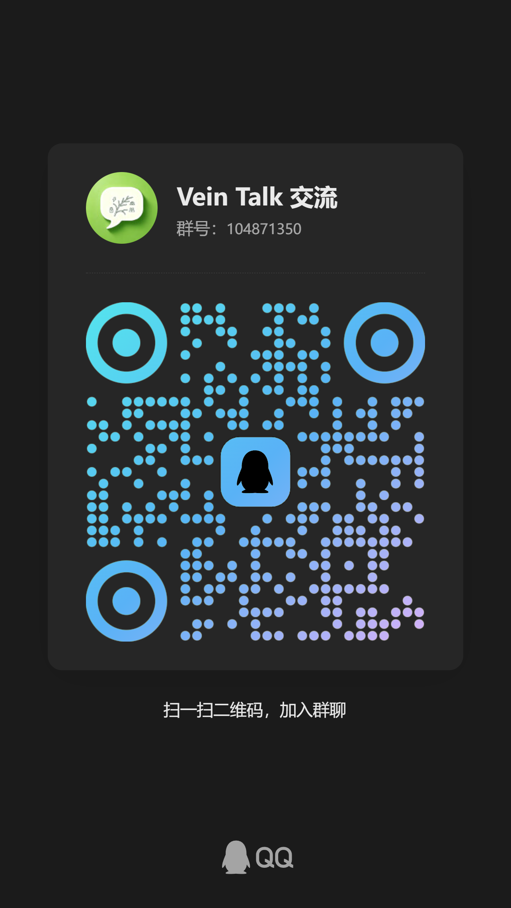

# 版权与使用声明

Copyright © 2026 朱亮 (Zhu Liang) / coos / TeamIDE. All rights reserved.

## 一、软件性质

vein-talk 为**商业专有软件（Proprietary Software）**，源码不公开。本仓库不包含任何源代码，仅用于产品介绍、测试评估与文档发布。

## 二、公开内容授权范围

对本仓库中的文档、图片、证书等内容，以及 Releases 发布的安装包，仅允许：

- 查看、下载、安装并进行测试评估；
- 在注明出处的前提下引用文档内容。

未经版权方书面许可，禁止：

- 再分发、销售、出租本仓库内容；
- 修改、演绎、反向工程本软件；
- 将本软件或其组成部分用于商业用途。

## 三、商用授权

正式商用（面向企业、团队等提供生产服务）需另行购买授权并签订商务合同。

联系方式：QQ群（扫码添加）

## 四、许可条款（过渡版）

以下条款随安装包一同发布，使用安装包即视为同意：

1. 本软件仅供测试评估，禁止用于生产环境与商业用途；
2. 不得对软件进行修改、破解、反向工程；
3. 使用者的使用行为由使用者自行负责；
4. 版权方保留随时变更、停止提供本软件及服务的权利。

> 正式《软件许可协议》（EULA）将在商业化销售前出具并经法律审阅，届时以正式协议为准。
