# vein-talk

高并发的 IM（即时通讯）系统，支持私有化部署，多端使用。

> **当前状态**：移动端 Android 安装包 v1.0.10 已发布（[下载中心](docs/05-版本发布/00-下载中心.md)）；体验服务器已开放（`https://coos.top`）；服务端镜像等发布物筹备中。

## ⚠️ 免责声明

本软件仅供合法合规用途，禁止用于任何违法犯罪活动。使用前请务必阅读并同意 [免责声明](免责声明.md)。

## 界面预览

### 移动端

<table>
  <tr>
    <td align="center"><a href="images/screenshots/会话列表1.jpg">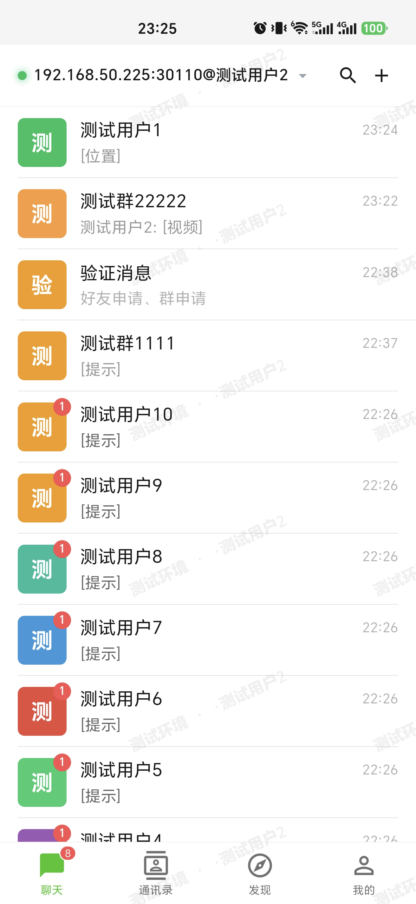</a> 会话列表</td>
    <td align="center"><a href="images/screenshots/聊天窗口1.jpg">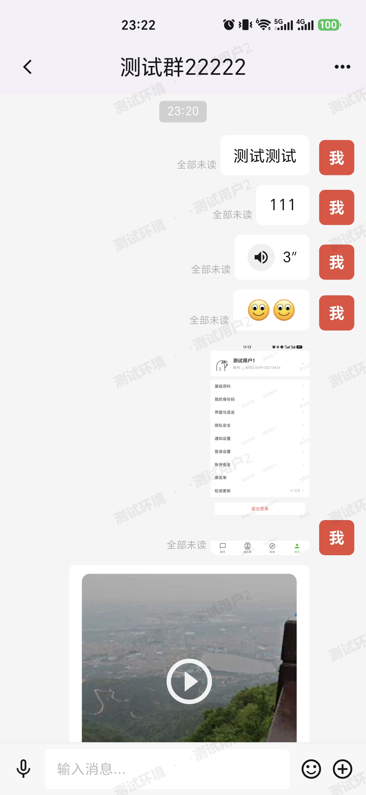</a> 聊天窗口</td>
    <td align="center"><a href="images/screenshots/聊天窗口2.jpg">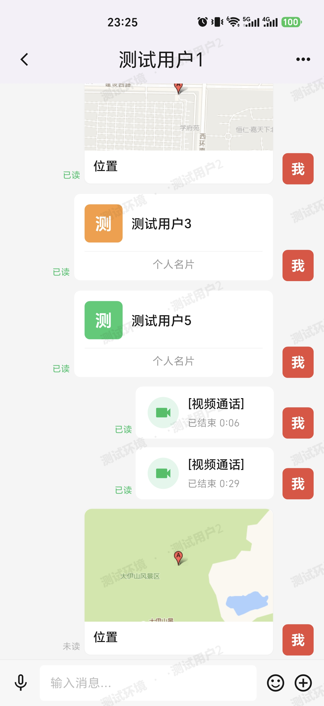</a> 聊天窗口</td>
    <td align="center"><a href="images/screenshots/通讯录1.jpg">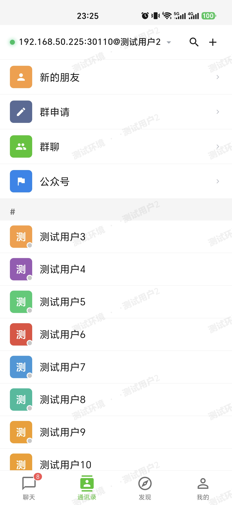</a> 通讯录</td>
    <td align="center"> 朋友圈</td>
  </tr>
  <tr>
    <td align="center"><a href="images/screenshots/收藏1.jpg">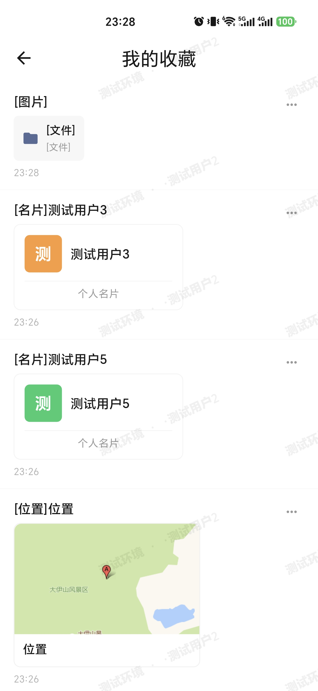</a> 收藏</td>
    <td align="center"><a href="images/screenshots/我的1.jpg">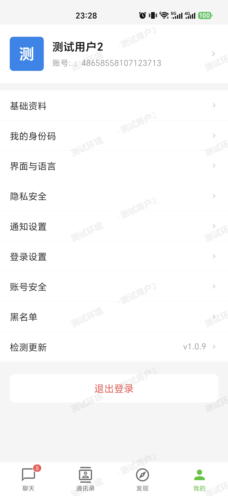</a> 我的</td>
    <td align="center"><a href="images/screenshots/界面和语言1.jpg">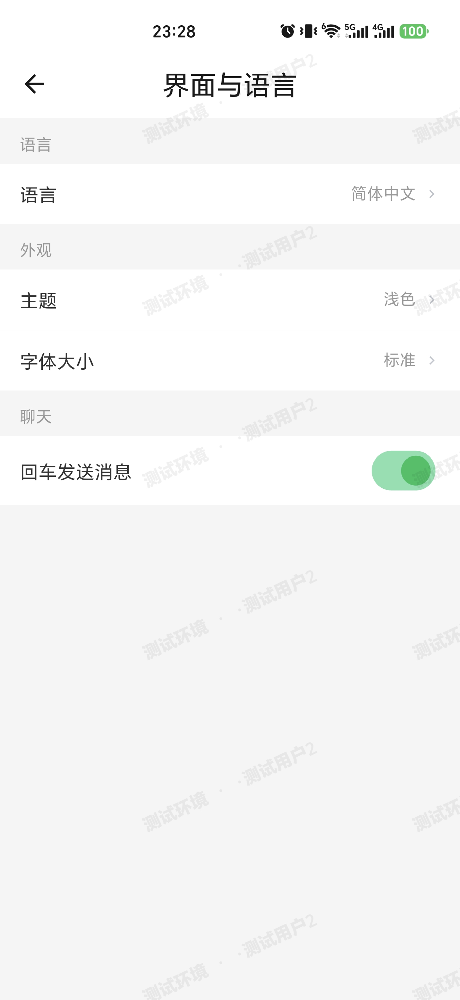</a> 界面与语言</td>
    <td align="center"><a href="images/screenshots/通知设置.jpg">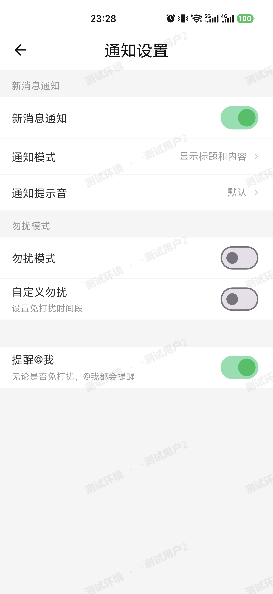</a> 通知设置</td>
    <td align="center"> 隐私安全</td>
  </tr>
</table>

### 门户 / 管理后台 / 公众平台

<table>
  <tr>
    <td align="center"><a href="images/screenshots/root/门户2.png">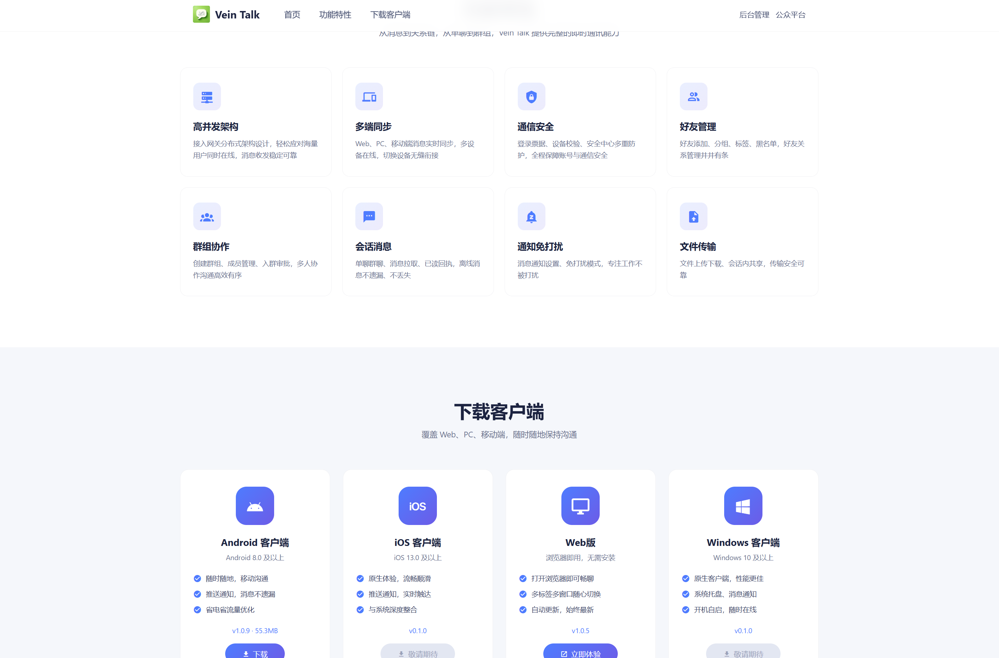</a> 门户</td>
    <td align="center"><a href="images/screenshots/manage/统计1.png">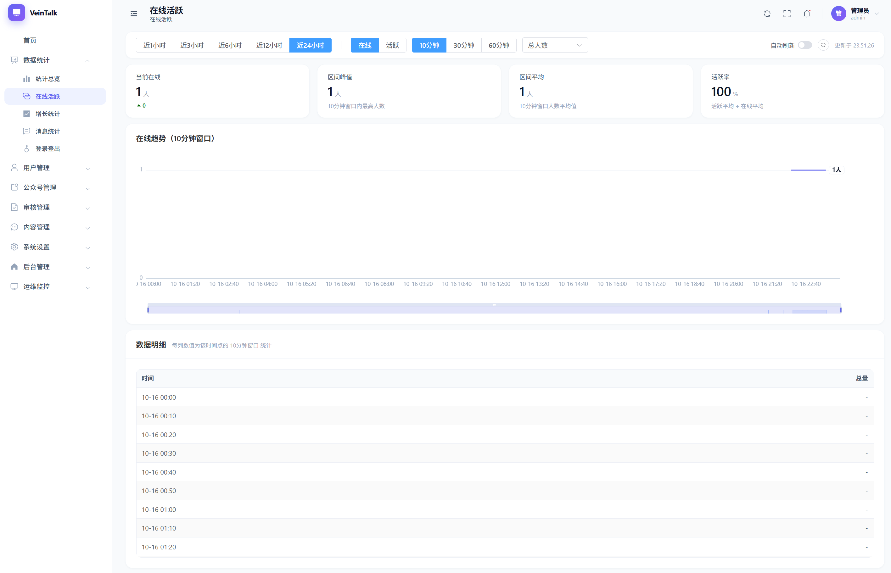</a> 管理后台 · 数据统计</td>
    <td align="center"><a href="images/screenshots/manage/用户1.png">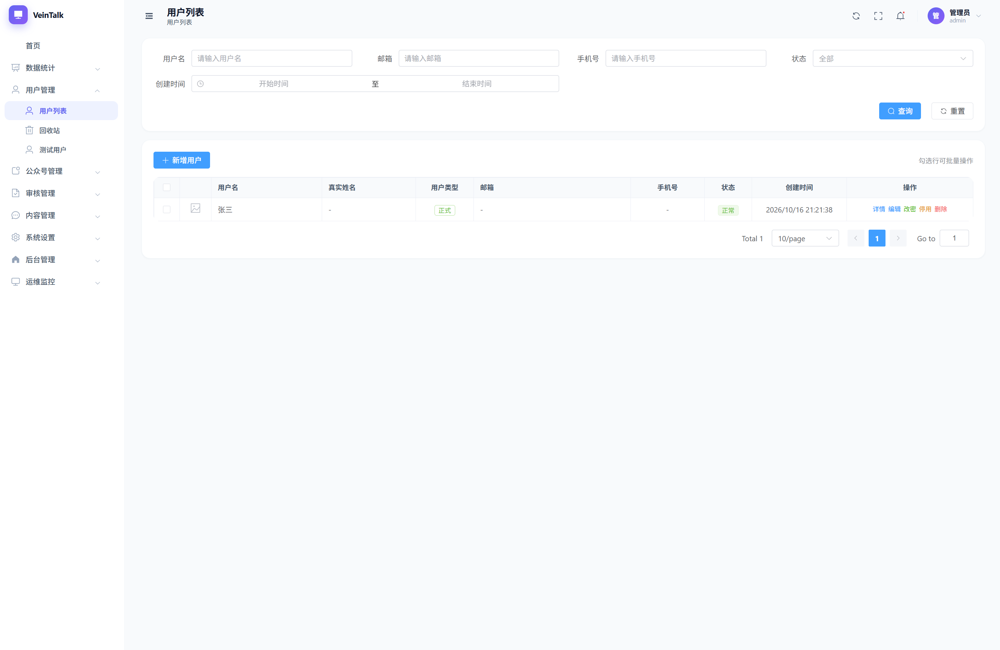</a> 管理后台 · 用户管理</td>
  </tr>
  <tr>
    <td align="center"><a href="images/screenshots/manage/公众号1.png">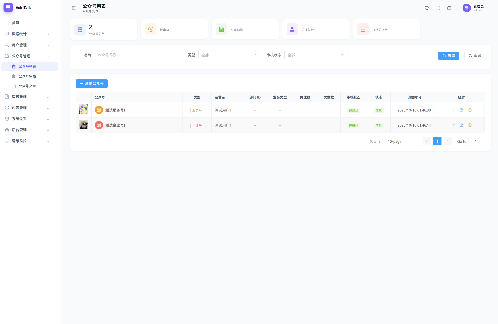</a> 管理后台 · 公众号管理</td>
    <td align="center"><a href="images/screenshots/platform/文章1.png">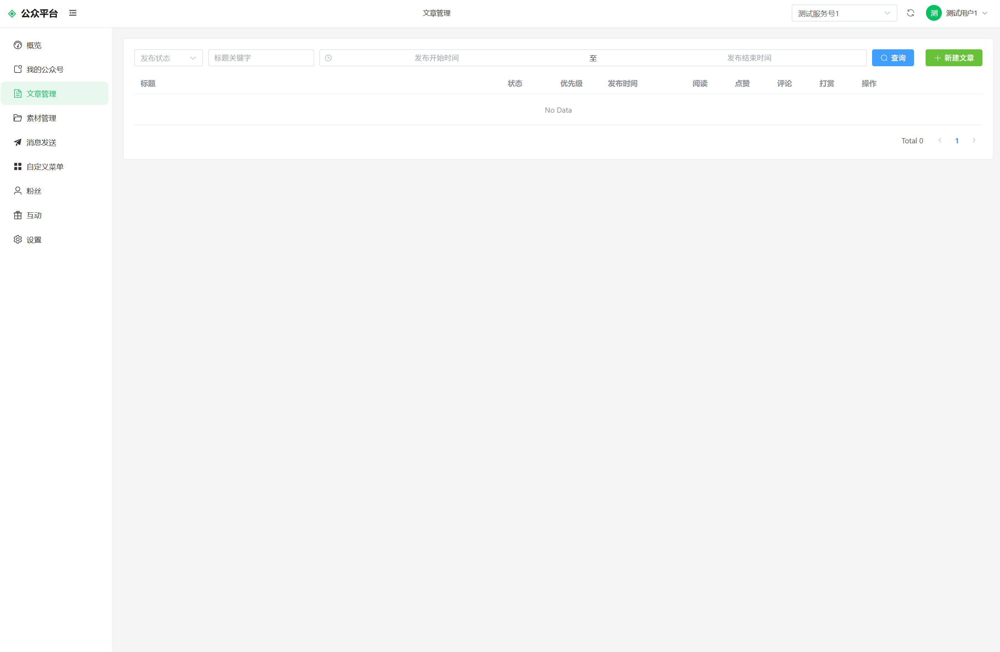</a> 公众平台 · 文章管理</td>
    <td align="center"><a href="images/screenshots/platform/菜单1.png">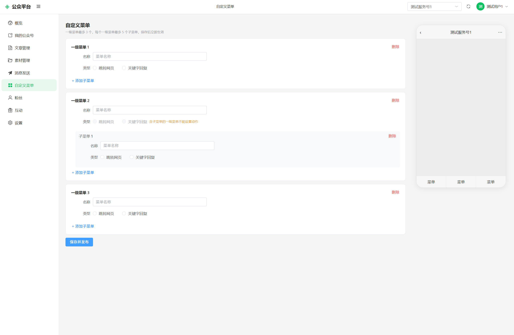</a> 公众平台 · 自定义菜单</td>
  </tr>
</table>

> 音视频通话等更多界面截图待补充；完整截图见各端使用说明（[移动端](docs/03-客户端使用/01-移动端使用说明.md) · [管理后台](docs/03-客户端使用/02-管理后台使用说明.md) · [公众平台](docs/03-客户端使用/03-公众平台使用说明.md) · [门户](docs/03-客户端使用/04-门户使用说明.md)）。

## 适用场景

- **企业内部沟通**：组织架构、单聊群聊、音视频通话
- **公告与强触达**：企业号发文、已读确认、一键催办
- **私域运营**：服务号群发、自定义菜单、关键字自动回复
- **知识沉淀**：知识号文章归档

更多场景与选型建议见 [使用场景](docs/01-项目介绍/02-使用场景.md)。

## 功能亮点

- **即时通讯**：单聊、群聊；文本、图片、语音、视频、文件、名片、位置、引用等消息类型；已读未读、撤回、多选转发、收藏
- **音视频通话**：语音 / 视频通话，单聊与群聊均支持
- **朋友圈**：发布、点赞、评论
- **公众号**：企业号、部门号、服务号、知识号 四类型；强触达、已读统计、自定义菜单、关键字自动回复
- **组织架构**：单位、部门管理
- **多端支持**：移动端、管理后台、公众平台、门户
- **私有化部署**：单机一键部署（集群、微服务规划中）
- **厂商离线推送**：华为、小米、OPPO、vivo、荣耀、iOS

完整功能见 [功能特性](docs/01-项目介绍/01-功能特性.md)。

## 快速体验

**只想先看看？** 下载移动端 → 连接体验服务器（`https://coos.top`）→ 开始使用，见 [快速体验](docs/03-客户端使用/00-快速体验.md)。

**想自己部署？** 获取服务端安装包 → 一键部署 → 连接自建服务器，见 [单机部署](docs/02-部署安装/02-单机部署.md)（面向运维）。

## 各端入口

| 端 | 说明 | 文档 |
|----|------|------|
| 移动端 | Android / iOS 客户端 | [快速体验](docs/03-客户端使用/00-快速体验.md) · [使用说明](docs/03-客户端使用/01-移动端使用说明.md) |
| 管理后台 | 用户 / 群 / 公众号管理、数据统计 | [管理后台使用说明](docs/03-客户端使用/02-管理后台使用说明.md) |
| 公众平台 | 公众号运营（文章、群发、菜单、统计） | [公众平台使用说明](docs/03-客户端使用/03-公众平台使用说明.md) |
| 门户 | 产品介绍与各端入口聚合 | [门户使用说明](docs/03-客户端使用/04-门户使用说明.md) |

## 常见问题

- **收费吗？** 本软件为商业专有软件，测试评估免费；正式商用需购买授权，见 [版权与使用声明](COPYRIGHT.md)
- **数据安全吗？** 支持私有化部署，数据由部署方自行管理，不经过第三方；消息内容加密存储，防止数据被直接读取
- **和微信有什么区别？** 微信为平台型 SaaS；vein-talk 可私有化部署、数据自主可控，并提供企业号强触达能力，见 [使用场景](docs/01-项目介绍/02-使用场景.md)
- **支持哪些设备？** Android / iOS 移动端；管理后台、公众平台、门户为 Web 端

## 文档导航

### 了解产品

| 文档 | 说明 |
|------|------|
| [功能特性](docs/01-项目介绍/01-功能特性.md) | 完整功能列表 |
| [使用场景](docs/01-项目介绍/02-使用场景.md) | 谁适合用、典型场景 |

### 客户端使用

| 文档 | 说明 |
|------|------|
| [快速体验](docs/03-客户端使用/00-快速体验.md) | 5 分钟上手 |
| [移动端使用说明](docs/03-客户端使用/01-移动端使用说明.md) | 移动端完整说明 |
| [管理后台使用说明](docs/03-客户端使用/02-管理后台使用说明.md) | 管理后台完整说明 |
| [公众平台使用说明](docs/03-客户端使用/03-公众平台使用说明.md) | 公众平台完整说明 |
| [门户使用说明](docs/03-客户端使用/04-门户使用说明.md) | 门户完整说明 |

### 部署运维（面向运维）

| 文档 | 说明 |
|------|------|
| [部署模式](docs/02-部署安装/01-部署模式.md) | 三种部署模式对比 |
| [单机部署](docs/02-部署安装/02-单机部署.md) | 一键部署 |
| [镜像与 Compose 详解](docs/02-部署安装/03-镜像与Compose详解.md) | 镜像构建、离线部署、备份 |
| [集群与微服务部署](docs/02-部署安装/04-集群与微服务部署.md) | 规划中 |

### 开发者（面向开发者）

| 文档 | 说明 |
|------|------|
| [技术架构](docs/04-开发与集成/01-技术架构.md) | 架构、服务、端口、通讯链路 |
| [OpenAPI 接入](docs/04-开发与集成/02-OpenAPI接入说明.md) | 第三方集成（暂无） |
| [测试证书](docs/04-开发与集成/03-测试证书说明.md) | 测试证书用途与使用 |

### 版本发布

| 文档 | 说明 |
|------|------|
| [下载中心](docs/05-版本发布/00-下载中心.md) | 安装包下载 |
| [更新日志](docs/05-版本发布/01-CHANGELOG.md) | 版本记录 |
| [更新路线图](docs/05-版本发布/02-更新路线图.md) | 功能规划 |

## 仓库地址

- GitHub：<https://github.com/team-ide/VeinTalk/>
- Gitee：<https://gitee.com/teamide/VeinTalk/>

## 讨论群

QQ（扫码添加）：

  

## 版权

本软件为商业专有软件，源码不公开。详见 [版权与使用声明](COPYRIGHT.md)。
