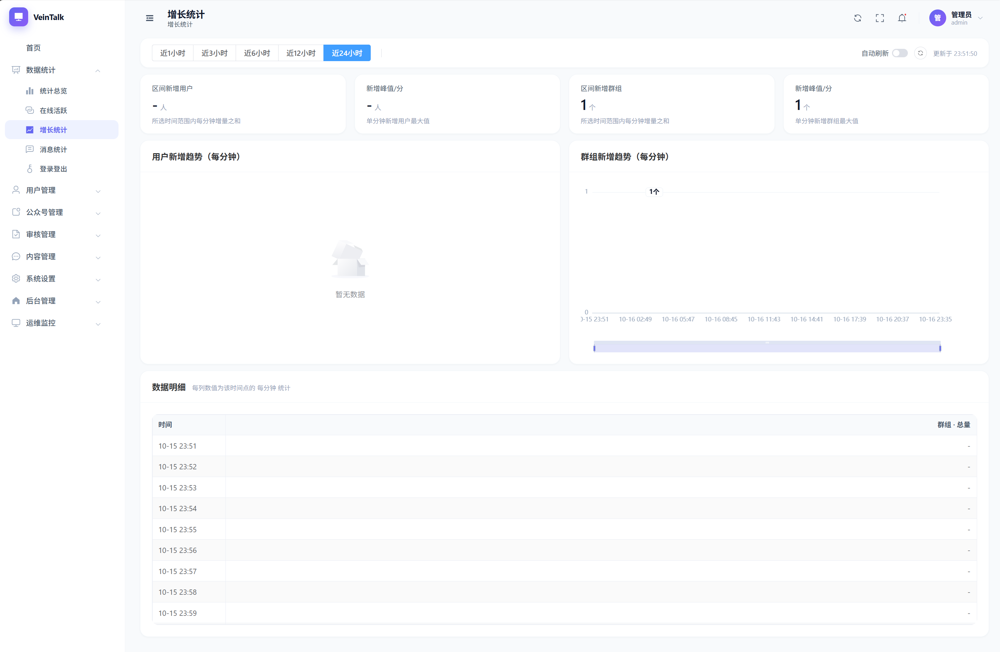
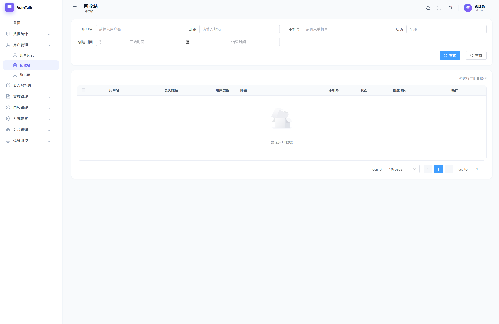
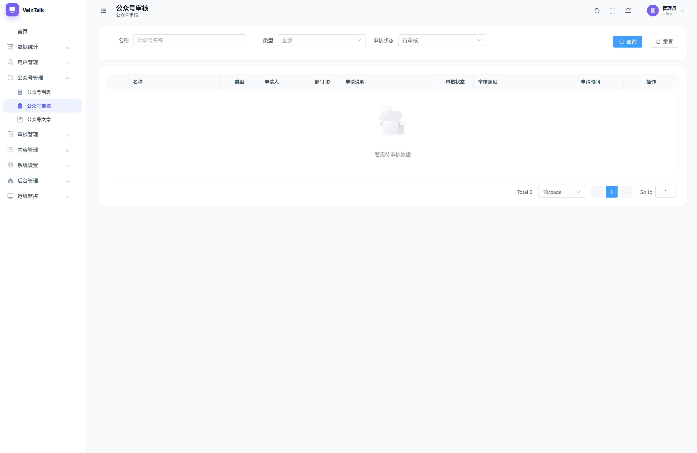

# 管理后台使用说明

管理后台（im-manage）为 IM 系统的管理控制台，用于用户管理、公众号审核、系统设置等。

<table>
  <tr>
    <td align="center"> 数据统计</td>
    <td align="center"> 在线活跃</td>
    <td align="center"> 用户管理</td>
  </tr>
  <tr>
    <td align="center"> 测试用户</td>
    <td align="center"> 公众号管理</td>
    <td align="center"> 公众号审核</td>
  </tr>
</table>

## 一、访问与登录

- 访问地址：部署方提供的后台地址，通常为 `http(s)://<域名>/vein-manage`（如 `https://vein-talk.com/vein-manage`，经 Nginx 入口，域名不带端口）
- 管理员账号由部署方初始化，请向部署方获取
- 登录页含图形验证码；勾选「记住账号」可下次自动填充

## 二、数据统计

菜单「数据统计」下各页面均支持时间范围预设（近 1/3/6/12/24 小时）与自动刷新：

- **统计总览**：当前在线、区间消息、区间登录/登出、区间新增用户/群组六项指标 + 图表
- **在线活跃**：在线/活跃切换，窗口 10/30/60 分钟，活跃率与峰值
- **增长统计**：用户与群组新增趋势
- **消息统计**：按消息总量/类型/会话类型/设备类型/设备品牌维度
- **登录登出**：登录与登出次数趋势

## 三、用户管理

- **用户列表**：按用户名/邮箱/手机号/状态/注册时间查询；操作：
  - 新增用户：基本信息 + 初始登录账号（可添加多个：账号/手机/邮箱/自定义类型），密码可手填或使用系统默认密码
  - 编辑：修改资料并管理该用户的全部登录账号
  - 详情、改密、启用/停用、删除（软删，进回收站）
  - 批量：启用、停用、删除、恢复、彻底销毁
- **测试用户**：查看测试用户列表；「生成测试用户」批量生成（支持表达式 `{index}` 序号占位，一次最多 1000 个，可选统一密码）
- **回收站**：已删除用户，可恢复或彻底销毁
- 用户类型：正式（1）/ 测试（2）/ 访客（3）

## 四、公众号管理

- **公众号列表**：查看全部公众号（含统计：公众号总数、待审核数、文章总数、关注总数、打赏总数）；新增公众号（企业号/服务号，指定运营者与部门）；编辑、启用/停用（仅审核通过后可启用）
- **公众号审核**：
  1. 用户在移动端/公众平台提交入驻申请
  2. 在「审核」页查看申请（申请人、部门、申请说明）
  3. 详情 → 通过 / 拒绝（拒绝需填写理由，200 字内，申请人可在申请记录中查看）
- **公众号文章**：查看全部文章与互动数据；可撤回（仅已发布）、删除；详情中含阅读统计（已读/未读/催办次数、点赞/收藏/评论/打赏）

## 五、系统设置

| 页面 | 说明 |
|------|------|
| 登录与注册 | 各端登录开关（PC/iOS/Android/Mac/Web）；多设备登录（含同类型多端）；注册开关/邀请注册；登录方式与账号类型；注册账号配置表（类型、必填、验证码、补充信息） |
| 密码策略 | 系统默认密码；密码复杂度规则；找回密码方式与验证码渠道（手机/邮箱） |
| 消息与存储 | 各类消息保存天数（0 不限）；客户端文件上传大小上限（1-1024MB）；通知显示方式与标题模板（支持 `$server`/`$name`/`$sender` 变量，实时预览） |
| 安全 | 密码更换周期；安全锁三组（账号锁/MAC 地址锁/IP 地址锁：失败次数、统计周期、锁定时长） |
| 测试用户 | 启用测试用户、一键登录开关、最大数量、有效期 |
| 客户端功能 | 邀请二维码使用当前服务器；单聊/群聊已读未读开关 |
| 全局参数 | 服务器名称、系统标题、使用用途（生产/测试/开发/演示——影响客户端警告横幅与水印）、设备信息存储阶段、水印开关与文案、警告横幅开关 |
| 许可证管理 | 查看当前许可证信息（签发方、最大用户数/在线数、群成员上限、文件传输上限、到期时间等）；证书来自部署环境 `conf/cert/license.crt`，不支持在线更新 |

> 设置项修改后即时生效或保存后生效；仅修改的字段会被提交保存。

## 六、后台管理

- **管理员管理**：新增/删除管理员（编辑请通过删除+新增完成）
- **角色管理**：新增/删除角色
- **操作日志**：查看管理员操作记录（请求路径、方法、IP、耗时）
- **登录日志**：查看后台登录记录（IP、来源、登录/登出时间）

## 七、常见问题

| 现象 | 处理 |
|------|------|
| 忘记管理员密码 | 联系部署方重置 |
| 验证码看不清 | 点击验证码图片刷新 |
| 公众号审核后客户端不显示 | 确认已「通过」且公众号为启用状态 |
| 修改设置不生效 | 部分设置需客户端重新登录/重新拉取后生效 |
