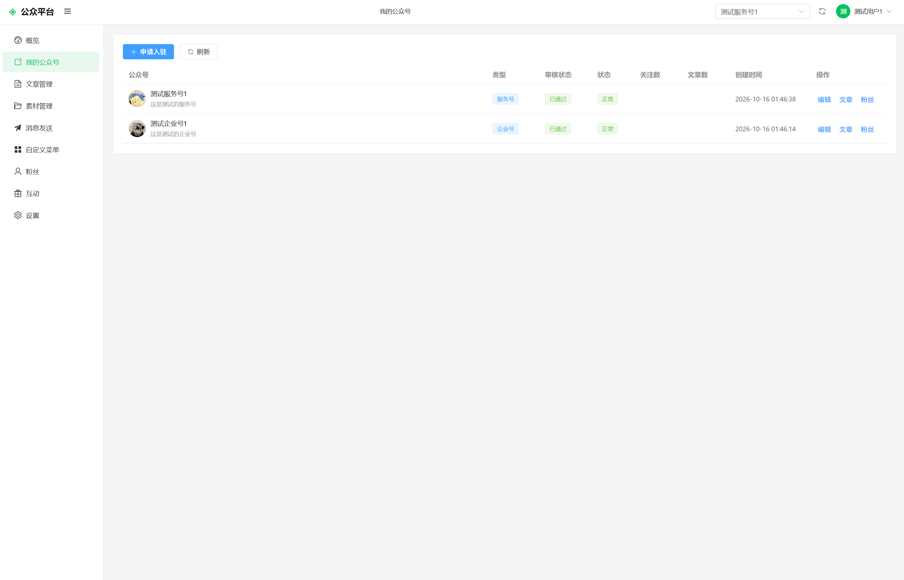
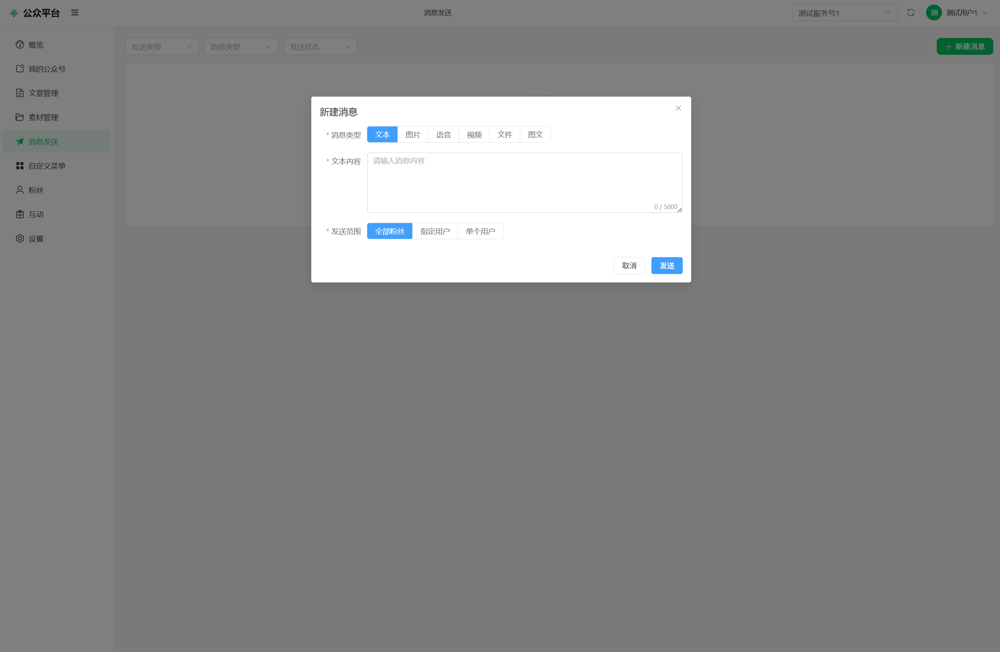
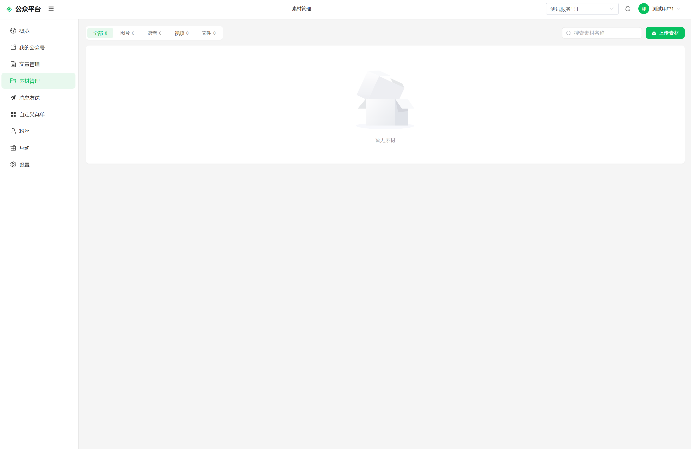

# 公众平台使用说明

公众平台（im-platform）是公众号 / 小程序运营端，用于入驻公众号、发布文章、群发消息、配置菜单、管理小程序等。

<table>
  <tr>
    <td align="center"> 我的公众号</td>
    <td align="center"> 文章管理</td>
    <td align="center"> 消息发送</td>
    <td align="center"> 素材管理</td>
    <td align="center"> 自定义菜单</td>
  </tr>
</table>

## 一、访问与登录

- 访问地址：部署方提供的公众平台地址，通常为 `http(s)://<域名>/vein-platform`（如 `https://vein-talk.com/vein-platform`，经 Nginx 入口，域名不带端口）
- 登录方式：
  - **账号密码登录**：使用 IM 账号登录
  - **扫码登录**：点击登录页二维码区域生成二维码 → 使用移动端「扫一扫」扫描 → 移动端确认后自动登录
- 顶部可切换「当前公众号」（最多展示 100 个你运营的公众号），各页面随切换自动刷新

## 二、入驻公众号

1. 进入「我的公众号」→「申请入驻」
2. 选择类型（当前开放申请：**部门/团队号**、**知识号**；企业号、服务号需由管理后台创建）
3. 填写名称（100 字内）、简介（500 字内）、头像；部门/团队号需填写部门 ID
4. 提交后等待管理后台审核；在「我的公众号」可查看审核状态（待审核/已通过/已拒绝及驳回原因）

## 三、素材管理

- 素材类型：图片 / 语音 / 视频 / 文件 四类
- 上传：选择类型 → 拖拽或选择文件（图片 jpg/png/gif、语音 mp3/wav、视频 mp4）→ 填写素材名称
- 素材支持重命名、删除；文章与群发中可直接引用素材

## 四、文章管理

- **新建文章**：
  - 标题（必填）、摘要、正文（纯文本）
  - **已读确认**：开关（企业号公告适用，开启后读者需点「确认已读」）
  - **优先级**：普通 / 重要 / 紧急
  - **定向部门**：填写部门 ID（0 表示全部粉丝可见）
  - 发布方式：存草稿 / 立即发布 / 定时发布
- **文章列表**：按状态（草稿/已发布/已撤回）、标题、时间筛选；草稿可编辑、发布；已发布可撤回、删除
- **文章详情**：
  - 互动数据：阅读、点赞、收藏、评论、打赏次数与金额
  - **已读确认统计**（已读确认文章）：已读/未读/粉丝统计、已读与未读名单、**一键催办未读**
  - 评论管理：查看与删除评论

## 五、消息发送（群发）

- 新建消息支持 6 种类型：文本（5000 字）、图片、语音、视频、文件（选素材）、图文（选文章，仅可选已到发布时间的文章）
- 发送范围：
  - **全部粉丝**（群发）
  - **指定用户**（多选，最多 200 人）
  - **单个用户**
- 发送后可查看进度与明细：目标/成功/失败人数、逐用户状态与失败原因

## 六、自定义菜单与关键字自动回复

- 进入「自定义菜单」：
  - 一级菜单最多 **3 个**，每个一级菜单子菜单最多 **5 个**
  - 菜单动作二选一：**跳转网页**（URL 须 http/https 开头）或 **关键字回复**
  - 含子菜单的一级菜单不能设置动作
- **关键字自动回复**：在菜单按钮中配置「关键字 + 回复内容（文本/图片素材/图文文章）」；用户向公众号发送该关键字时自动回复；关键字全局不能重复
- 保存并发布后生效；右侧手机预览面板可预览菜单效果

## 七、小程序管理

- **小程序列表**：查看我创建的小程序（名称、分类、图标、网址、可见范围、当前线上版本与审核状态）
- **创建 / 编辑**：名称、分类（内置分类）、图标、H5 网址、可见范围（公开 / 企业内——企业内仅同企业成员可见）；创建者需属于所填企业；资料修改即时生效
- **申请发布**：提交新版本审核；已有版本待审核时不能重复提交
- **版本记录**：查看全部版本与审核状态（待审核 / 已通过 / 已拒绝及原因）；新版本过审前旧线上版本保持在线
- 审核通过后，移动端「发现页」按分类展示，用户点击即可打开使用

## 八、粉丝与互动

- **粉丝**：查看粉丝列表（关注类型：主动关注/强制关注）
- **互动**：选择文章查看**打赏记录**（总金额与明细）

## 九、设置

- 查看账号信息（用户 ID、用户名、手机号、状态）；退出登录

## 十、常见问题

| 现象 | 处理 |
|------|------|
| 扫码后无法登录 | 二维码 2 分钟有效，过期请刷新重试；移动端需登录同一服务器 |
| 申请被驳回 | 在「我的公众号」查看驳回原因，修改后重新提交 |
| 群发部分失败 | 查看发送明细的失败原因（多为用户已取关或设备无推送通道） |
| 菜单保存后不生效 | 确认点击了「保存并发布」 |
