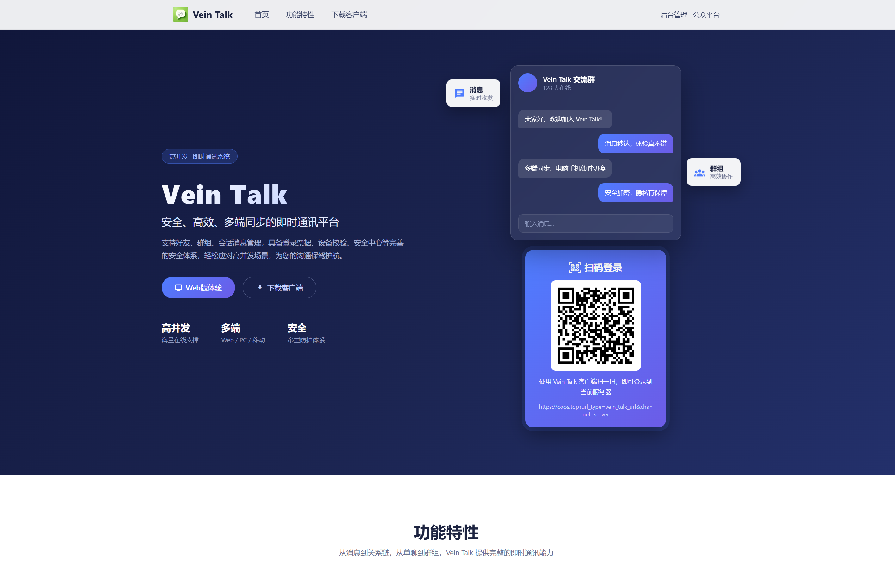

# 门户使用说明

门户（im-root）是随服务端部署的对外门户站点：产品介绍 + 各功能入口聚合 + 客户端下载。

   
  门户首页

   
  门户首页（下载区）

## 一、访问地址

- 门户随服务端 Nginx 静态托管，通常直接以域名访问、不带端口：`http(s)://<域名>`（如 `https://vein-talk.com`）
- 服务端内部监听 10101（HTTP）/ 10102（HTTPS），由 Nginx 配置 80/443 与域名对外

## 二、页面说明

### 首页

- **产品介绍区**：项目定位、核心卖点（高并发 / 多端 / 安全）、功能特性展示
- **扫码登录卡片**：展示服务器二维码，移动端扫码可快速添加服务器
- **入口按钮**（右上角）：
  - 「后台管理」→ 打开本服务器的管理后台
  - 「公众平台」→ 打开本服务器的公众平台
- **下载区**：各客户端下载卡片（移动端 / Web / 桌面端），含版本、大小与下载按钮；「智能下载」入口；安装步骤与系统要求说明

### 智能下载页（#/download）

- 自动识别访问设备（Android / iOS / Windows / macOS / Linux 及 CPU 架构）
- 为当前设备推荐最匹配的客户端并标注「推荐」
- 在微信内置浏览器打开时显示引导提示（微信内无法直接下载）

## 三、配置说明（维护者向）

门户为静态配置驱动，无需改代码即可调整内容。配置文件：`public/data.json5`（部署时挂载 `/data/vein-talk/app/` 覆盖镜像内置版本）。

| 配置 | 说明 |
|------|------|
| 站点信息 | 名称、浏览器标题、徽标、口号、描述、页脚、扫码服务器地址、更新说明 |
| `links` | 入口链接：后台管理 / 公众平台 / Web 客户端 / 安全中心 |
| `clients` | 客户端清单：名称、说明、版本、大小、下载链接（按平台与架构变体）、开放状态 |

修改配置后替换挂载文件并刷新页面（禁用缓存拉取，无需重启服务）。

## 四、常见问题

| 现象 | 处理 |
|------|------|
| 下载按钮不可用 | 该客户端在配置中标记为未开放（敬请期待），待发布后由维护者更新配置 |
| 微信内无法下载 | 微信内置浏览器限制，请用系统浏览器打开 |
| 扫码添加服务器失败 | 确认移动端与门户配置的是同一服务器地址 |
