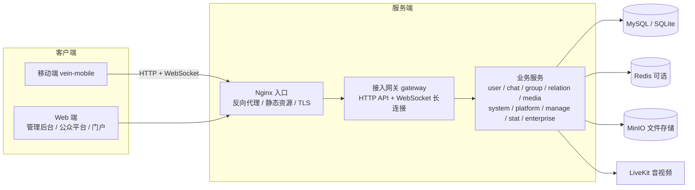

# 技术架构（开发者参考）

> 本文面向开发者与运维，介绍服务端技术架构。普通客户请阅读 [功能特性](../01-项目介绍/01-功能特性.md) 与 [使用场景](../01-项目介绍/02-使用场景.md)。

## 总体架构

- 客户端统一经**接入网关**访问：HTTP 接口走 `/vein-gateway/`，实时消息走 WebSocket `/vein-gateway/access`
- 服务端目前以**聚合服务 server-all** 单进程交付（单机部署），服务间以进程内调用与事件广播协作

## 服务清单

| 服务 | 职责 |
|------|------|
| gateway | 接入网关：WebSocket 长连接、在线状态、客户端全量 API、静态资源托管、文件上传、LiveKit 凭证签发、通话房间信令转发 |
| user | 用户：资料 / 账号 / 密码 / 设备 / 登录票据 / 收藏 / 用户设置 / 登录日志 |
| auth | 登录鉴权：登录 / 登出 / 票据 / 踢人 / 登录日志 |
| chat | 聊天：会话 / 成员、消息发送与存储、云端离线推送、通知设置、申请单、通话房间与通话记录、群接龙 / 群投票、公众号菜单关键字回复 |
| group | 群：群信息 / 成员 / 成员事件（入群 / 退群 / 转让 / 解散）、企业内部群校验 |
| relation | 关系：好友 / 分组 / 标签 / 黑名单 / 朋友圈 |
| media | 媒体：上传任务 / 媒体信息 / 文件记录（MinIO） |
| system | 系统：设置项 / 默认密码策略 / 配额 / 许可证验证 |
| manage | 管理后台服务：用户 / 群 / 消息 / 统计 / 敏感词 / IP 黑名单 / 许可证 / 意见反馈 / 缓存管理 / 企业组织透传 |
| platform | 公众平台：公众号申请审核 / 关注 / 文章 / 素材 / 群发 / 自定义菜单 / 扫码登录 / 小程序与版本审核 |
| stat | 统计：在线 / 活跃 / 登录 / 消息 / 用户 / 群计数与定时聚合 |
| enterprise | 企业：企业 / 组织机构 / 组织用户 / 批量导入 / 企业通讯录查询 |

> 以上服务在单机部署中由 `server-all` 聚合为单进程；微服务部署形态下各自独立运行。

## 部署形态

| 维度 | 单机部署 | 集群部署（规划中） | 微服务部署（规划中） |
|------|----------|--------------------|----------------------|
| 服务形态 | 单个聚合服务（server-all） | 单个聚合服务（server-all） | 多个独立服务 |
| 进程 | 单进程 | 多进程 | 多进程 |
| 接入网关 | 单接入网关 | 多接入网关 | 多接入网关 |
| 注册中心 | — | ZK | ZK |
| 配置中心 | — | etcd | etcd |
| 缓存 | 内存 或 Redis | Redis | Redis |
| 队列 | 内存 或 Kafka | Kafka | Kafka |
| 数据库 | SQLite 或 MySQL | MySQL | MySQL |
| 文件存储 | MinIO | MinIO | MinIO |
| 入口 | Nginx | Nginx | Nginx |
| 适用规模 | 小规模 / 测试 | 中大并发 | 大规模 / 按需伸缩 |
| 状态 | ✅ 已适配 | ⏳ 规划中 | ⏳ 规划中 |

> 详见 [部署模式](../02-部署安装/01-部署模式.md)。

## 技术栈

| 层 | 技术 |
|----|------|
| 服务端语言 | Go |
| 代码生成 | coos（模型 / 服务 / 存储 / 建表自动生成） |
| 基础框架 | team-ide framework（生命周期 / DB / 缓存 / 日志 / Web） |
| 接口协议 | protobuf + gRPC（服务间）；HTTP JSON（对外 API） |
| 实时通道 | WebSocket + protobuf 二进制帧（心跳 / 增量拉取） |
| 客户端 | Flutter（移动端）、Vue3（管理后台 / 公众平台 / 门户） |

## 中间件

| 组件 | 用途 |
|------|------|
| MySQL 8.4 / SQLite | 业务数据库（各服务独立库，可按服务切换） |
| Redis 7 | 缓存层（可选，缺省使用内存缓存）、票据 / 验证码 / 在线状态 |
| MinIO | 文件存储（头像 / 聊天 / 内部 / 素材 四个桶，预签名上传下载） |
| LiveKit | 音视频通话（房间 Token 签发） |
| Nginx | 反向代理 / 静态资源 / TLS |
| etcd | 动态配置中心（可选，集群部署使用） |
| 厂商推送 SDK | 华为 HMS / 小米 / OPPO / vivo / 荣耀 / APNs（服务端直连） |

## 默认端口与路径

| 服务 | 端口 | 说明 |
|------|------|------|
| web_gateway | 30110 | 客户端 HTTP API，context `/vein-gateway/` |
| web_gateway（WebSocket） | 30110 | 长连接，路径 `/vein-gateway/access` |
| web_manage | 30113 | 管理后台 API，context `/vein-im-manage/` |
| web_platform | 30114 | 公众平台 API，context `/vein-im-platform/` |
| 门户 / Web 客户端 | 30110 静态资源 | `/vein-root/`、`/vein-mobile/` |
| LiveKit | 7881 / 7882 | 音视频媒体 |
| MySQL / Redis / MinIO / Nginx | — | 见部署文档 |

> 管理后台、公众平台的**页面静态路径**为 `/vein-manage/`、`/vein-platform/`，与 **API 路径** `/vein-im-manage/`、`/vein-im-platform/` 同端口（30113 / 30114）不同 context；门户站点由 Nginx 托管（10101 / 10102，服务端 30110 亦提供 `/vein-root/` 静态资源）。

## 通讯链路

1. **长连接**：客户端与服务端建立 WebSocket，protobuf 二进制帧通信，心跳保活（25s ping / 10s pong 超时），断线指数退避重连
2. **消息流**：发送 → gateway → chat 服务落库 → 在线接收方经长连接实时下发；离线消息经拉取补齐
3. **离线推送**：接收方离线时，chat 服务生成推送任务，按设备厂商经对应推送通道（华为 / 小米 / OPPO / vivo / 荣耀 / APNs）送达
4. **在线状态**：网关维护连接与设备状态，多设备取最高优先级展示（手机 > PC > Web）
5. **音视频**：客户端向 gateway 申请 LiveKit 凭证（jwt），加入房间后媒体流直接与 LiveKit 交互；通话信令经既有 WS 长连接上的「房间信令」通道（不进消息库）由 chat 服务转发，通话状态（成员 / 模式 / 举手 / 管理操作）由服务端权威维护
6. **富消息状态**：群接龙 / 群投票 / 通话卡片采用「消息快照 + 按需拉取状态 + 在线事件刷新」模式，状态变更经不落库的事件消息在线推送

## 文件存储

- 上传流程：客户端 `upload/create` 获取上传信息 → 直传 MinIO → 消息内容携带文件路径
- 四个桶：`avatar`（头像，公开读）、`chat`（聊天文件，公开读）、`inside`（内部，私有）、`material`（公众号素材，公开读）

## 表结构管理

- 表结构由 coos 模型定义，**服务启动时自动检测并安装新增表、字段、索引**，无需手动执行 SQL

## 业务能力技术细节

以下能力的实现细节（自 [功能特性](../01-项目介绍/01-功能特性.md) 移入）：

| 能力 | 实现说明 |
|------|----------|
| 许可证验证 | 服务端加载 license.crt 校验授权：最大用户数 / 最大在线数 / 群成员上限 / 文件大小等 |
| 群聊已读明细 | 群成员已读名单可由服务端开关控制 |
| 移动端 H5 应用 | 内置浏览器 JS-SDK（15 个原生能力、可信域名校验），见 [OpenAPI 接入说明](02-OpenAPI接入说明.md) |
| 隐私政策门禁 | 客户端首次启动强制展示隐私政策，同意后才初始化第三方 SDK |
| 消息内容加密存储 | 消息内容在数据库中加密存储，防止数据库被直接读取时泄露消息明文 |
| 通话房间信令 | 每次通话创建临时房间（roomId 服务端生成），服务端内存维护权威状态（成员 / 讨论·讲座模式 / 举手 / 管理操作）；讨论 / 讲座模式仅发起人可切换；忙线按「一用户同时只在一通通话」判定 |
| 群接龙 / 群投票 | 新增消息类型（接龙 16 / 投票 17），卡片 content 为快照，实时状态经 API 拉取；发起人管理操作（结束 / 重开 / 删除）服务端校验身份 |
| 企业内部群 | 群类型新增「内部群」，建群 / 邀请 / 申请时按企业·组织成员关系校验，非企业成员自动拒绝；企业 / 部门字段创建后不可改 |
| 小程序发布审核 | 资料表 + 版本表分离：资料修改即时生效，发布走版本审核（待审 / 通过 / 拒绝）；线上版本 = 最新已通过版本；可见性分公开 / 企业内全员 |
| 意见反馈 | 客户端提交反馈（图片 / 视频 / 日志经文件服务上传），管理后台查看处理；反馈含设备信息与客户端版本 |
| 图片缩略图 | 网关图片上传自动生成缩略图（最长边 480px），客户端 / Web 端缩略图优先加载、失败回退原图 |
| 运维缓存管理 | 管理后台按缓存定义表统计 / 清理各业务缓存，支持本地与 Redis 两种缓存模式 |
